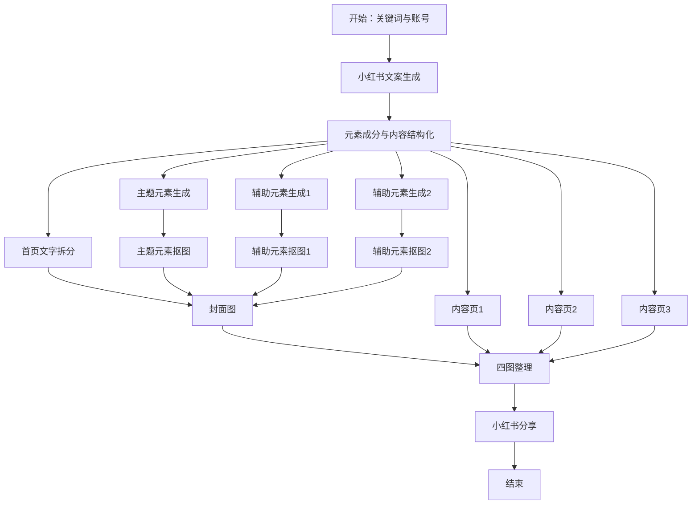
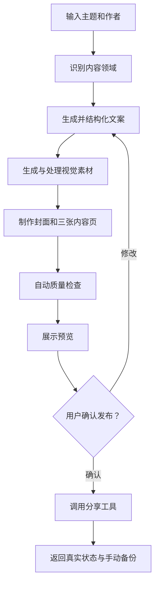

# Coze 工作流：小红书一键生成图文

## 一、工作流概览

该工作流用于把用户输入的关键词或原始文本转换为一套小红书图文内容，并依次完成文案生成、内容结构化、视觉元素生成、元素抠图、封面制作、三张内容页制作、图片整理和小红书分享。

| 项目 | 内容 |
| --- | --- |
| 平台 | Coze（www.coze.cn） |
| 工作流模式 | 标准工作流 |
| 节点数量 | 17个 |
| 连线数量 | 22条 |
| 输入 | 关键词/原始内容、账号或作者信息 |
| 输出 | 1张封面、3张内容页及分享结果 |

> 安全说明：原始工作流中包含明文发布插件 API Key。本文件已将密钥删除，不展示、不保存真实值。旧密钥应在对应平台重置。

## 二、工作流目标

1. 识别用户输入的主题并生成小红书风格文案。
2. 将文案整理为主标题、副标题、九个小标题和九段正文。
3. 提取一个主题元素和两个辅助元素。
4. 生成并抠出三个视觉元素。
5. 将主标题和副标题拆分成适合封面的两行文字。
6. 制作一张封面和三张内容页。
7. 按封面、内容页1、内容页2、内容页3的顺序整理图片。
8. 将图片、标题和正文传递给小红书分享插件。

## 三、整体流程



## 四、节点说明

### 1. 开始

**节点ID：** `100001`  
**节点类型：** 开始节点

输入工作流运行所需的信息。

| 输出变量 | 类型 | 说明 |
| --- | --- | --- |
| `kw` | string | 用户输入的关键词或原始内容，必填 |
| `zhanghao` | string | 账号、作者名或署名信息，可选 |

### 2. 小红书文案生成

**节点ID：** `190438`  
**节点类型：** 大模型  
**模型：** 豆包·2.0·pro

将用户输入的任意文本转换为小红书笔记，生成标题、正文和话题标签。

主要规则：

- 自动识别好物推荐、教程、日常分享、美食、旅行等内容类型；
- 标题突出类型、核心关键词、情绪或效果；
- 正文采用开头共鸣、分点说明、结尾总结的结构；
- 根据领域自然搭配 Emoji；
- 生成5～10个话题标签；
- 避免敏感内容、虚假宣传和硬广式表达。

| 输入 | 来源 |
| --- | --- |
| `output` | 开始节点的 `kw` |

| 输出 | 类型 |
| --- | --- |
| `output` | string |
| `reasoning_content` | string |

### 3. 元素成分

**节点ID：** `189374`  
**节点类型：** 大模型  
**模型：** 豆包·2.0·pro

对生成的文案进行结构化处理，输出页面文字和视觉元素。

主要输出：

- 主标题 `title`；
- 副标题 `subtitle`；
- 主题元素 `main_image`；
- 两个辅助元素 `element_img1`、`element_img2`；
- 九个小标题 `sub_title1`～`sub_title9`；
- 九段正文 `content1`～`content9`。

原始提示词将该节点定义为“养生达人”，因此当前版本更适合养生类内容。如果要支持任意领域，应将角色修改为通用的小红书内容结构化助手，避免非养生主题被错误改写。

### 4. 主题元素生成

**节点ID：** `115445`  
**节点类型：** 图片生成节点

根据 `main_image` 生成封面所需的主题视觉元素。

| 输入 | 输出 |
| --- | --- |
| `main_image` | `data`：生成图片；`msg`：状态信息 |

### 5. 辅助元素生成1

**节点ID：** `185636`  
**节点类型：** 图片生成节点

根据 `element_img1` 生成第一个辅助视觉元素。

### 6. 辅助元素生成2

**节点ID：** `141196`  
**节点类型：** 图片生成节点

根据 `element_img2` 生成第二个辅助视觉元素。

### 7. 主题元素抠图

**节点ID：** `167549`  
**插件：** 抠图 `cutout`

去除主题元素背景，输出透明背景PNG素材。

| 参数 | 设置 |
| --- | --- |
| `url` | 主题元素生成结果 |
| `output_mode` | 0，透明背景图 |
| `only_mask` | 0，输出抠图结果尺寸 |

### 8. 辅助元素抠图1

**节点ID：** `169775`  
**插件：** 抠图 `cutout`

去除第一个辅助元素的背景，输出透明背景素材。

### 9. 辅助元素抠图2

**节点ID：** `160420`  
**插件：** 抠图 `cutout`

去除第二个辅助元素的背景，输出透明背景素材。

### 10. 首页文字拆分

**节点ID：** `143075`  
**节点类型：** 大模型  
**模型：** 豆包·2.0·pro

把主标题和副标题分别拆成适合封面排版的两行文字，并保持原字符顺序和内容不变。

| 输入 | 输出 |
| --- | --- |
| `title` | `title1`、`title2` |
| `subtitle` | `subtitle1`、`subtitle2` |

### 11. 封面图

**节点ID：** `153832`  
**节点类型：** 画板/图片排版节点

组合以下内容制作封面：

- 主题抠图；
- 两个辅助元素抠图；
- 两行主标题；
- 两行副标题；
- 账号或作者信息。

输出封面图片 `data`。

### 12. 内容页1

**节点ID：** `129186`  
**节点类型：** 画板/图片排版节点

使用总标题以及第1～3组小标题和正文制作第一张内容页。

### 13. 内容页2

**节点ID：** `109747`  
**节点类型：** 画板/图片排版节点

使用总标题以及第4～6组小标题和正文制作第二张内容页。

### 14. 内容页3

**节点ID：** `116382`  
**节点类型：** 画板/图片排版节点

使用总标题以及第7～9组小标题和正文制作第三张内容页。

### 15. 小红书图片整理

**节点ID：** `186516`  
**节点类型：** 变量聚合节点

将四张图片整理成列表，顺序为：

1. 封面图；
2. 内容页1；
3. 内容页2；
4. 内容页3。

输出变量为 `output`，类型为图片列表。

### 16. 小红书分享

**节点ID：** `101779`  
**插件：** 小红书发布_智界小红书分享  
**接口：** `shareToXiaohongshu`

| 输入参数 | 来源或说明 |
| --- | --- |
| `apiKey` | 应使用平台安全密钥配置，不得明文写入工作流 |
| `images` | 小红书图片整理节点的四图列表 |
| `content` | 小红书文案生成节点的正文 |
| `title` | 元素成分节点的主标题 |

主要输出：

- `success`：请求是否成功；
- `message`：响应消息；
- `result.pageUrl`：分享页面地址；
- `result.qrCodeUrl`：二维码地址；
- `result.expireTime`：页面过期时间；
- `result.usage`：本次调用费用与剩余余额；
- `result.content`：实际处理后的标题、正文和图片。

该插件输出的页面或二维码属于分享结果，不能在未检查真实响应时宣称已经成功发布到小红书。

### 17. 结束

**节点ID：** `900001`  
**节点类型：** 结束节点

返回工作流最终结果，包括封面图和三张内容页。

## 五、节点连接关系

| 上游节点 | 下游节点 |
| --- | --- |
| 开始 | 小红书文案生成 |
| 小红书文案生成 | 元素成分 |
| 元素成分 | 主题元素生成 |
| 元素成分 | 辅助元素生成1 |
| 元素成分 | 辅助元素生成2 |
| 元素成分 | 首页文字拆分 |
| 元素成分 | 内容页1 |
| 元素成分 | 内容页2 |
| 元素成分 | 内容页3 |
| 主题元素生成 | 主题元素抠图 |
| 辅助元素生成1 | 辅助元素抠图1 |
| 辅助元素生成2 | 辅助元素抠图2 |
| 首页文字拆分 | 封面图 |
| 三个抠图节点 | 封面图 |
| 封面图 | 小红书图片整理 |
| 内容页1～3 | 小红书图片整理 |
| 小红书图片整理 | 小红书分享 |
| 小红书分享 | 结束 |

## 六、数据流说明

### 文案数据流

```text
用户关键词
→ 小红书完整笔记
→ 标题、副标题、九组正文和视觉元素
→ 封面文字与三张内容页文字
```

### 图片数据流

```text
主题元素与两个辅助元素
→ 三张生成素材
→ 三张透明背景抠图
→ 封面图
→ 与三张内容页合并为四图列表
```

### 发布数据流

```text
四图列表 + 标题 + 正文
→ 小红书分享插件
→ 分享页面、二维码、费用和真实状态
```

## 七、当前工作流的主要问题

### 1. 内容领域被写死

“元素成分”节点固定为养生达人。非养生主题可能被强行改写为养生内容，应改为通用领域识别或按领域分支。

### 2. API Key 明文保存

发布节点把 API Key 直接写进节点参数。复制或导出工作流时会一起泄露，应立即重置旧密钥，并改用平台密钥管理功能。

### 3. 缺少发布前确认

当前流程在四图整理后直接调用分享插件。建议增加“用户确认”节点，只有用户确认标题、正文和图片后才进入分享步骤。

### 4. 缺少质量检查

建议在发布前增加以下检查：

- 标题拆分后是否与原标题一致；
- 是否正好生成四张图片；
- 三张内容页是否各有三组内容；
- 每段正文是否满足字数要求；
- 图片顺序、文字可读性和接口状态是否正确。

### 5. 缺少失败分支

图片生成、抠图、排版或分享失败时，应只重试失败节点，并保留已经生成的内容，避免整条工作流重新运行和重复扣费。

## 八、建议的优化版流程



优化后应做到：先检查、再预览、后确认；发布失败时保留四图、标题、正文和标签，转为手动发布。

## 九、安全要求

- 不在文档、工作流、代码或截图中展示真实 API Key。
- 不把账号密码、Cookie、Token 写入节点常量。
- 使用平台密钥配置或运行环境变量。
- 分享工作流前检查 `apiKey`、`authorization`、`token`、`cookie` 等字段。
- 已经公开或发送过的密钥应立即作废并重新生成。

## 十、最终产物

工作流正常运行后，应得到：

1. 一张小红书封面；
2. 三张小红书内容页；
3. 完整标题和正文；
4. 话题标签；
5. 四图列表；
6. 分享页面或手动发布材料；
7. 真实的运行、费用和错误状态。
